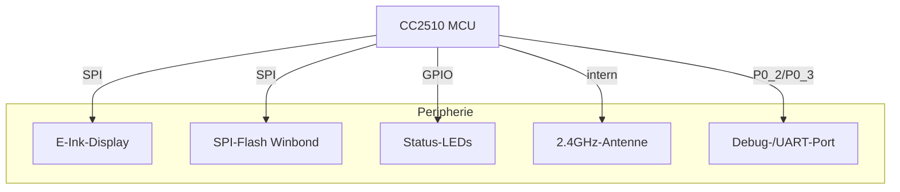

# 01. Projektüberblick

## Überblick
Dieses Projekt entwickelt eine eigene Firmware für **elektronische Preisschilder (ESL – Electronic Shelf Labels)** auf Basis des Mikrocontrollers **Texas Instruments CC2510**. Hauptziel ist, diese vorhandene Hardware zweckzuentfremden, um E-Paper-Displays (EPD) anzusteuern und eine drahtlose Kommunikation aufzubauen.

Das System steuert das Display, verwaltet einfache Peripherie wie LEDs und kommuniziert per Funk (RF) sowie über einen emulierten seriellen Port (UART) mit dem COBS-Protokoll.

## Unterstützte Hardware
Die Firmware ist speziell für die Hardware bestimmter kommerzieller ESL-Tags (z. B. der Marke SES-imagotag) gedacht, die „gehackt"/zweckentfremdet wurden.

### Hauptkomponenten
1.  **MCU: Texas Instruments CC2510**
    *   Verbesserter 8051-Kern.
    *   Integrierter 2,4-GHz-RF-Transceiver.
    *   32 KB programmierbarer Flash, 4 KB RAM.
    *   I2S-Schnittstelle, DMA, Timer, ADC.

2.  **Display: Pervasive Displays (E-Paper)**
    *   E-Ink-Spectra-Technik (Weiß, Schwarz, Rot).
    *   Gängige Größen: 2,2", 2,6", 4,2".
    *   Integrierter Controller (COG – Chip On Glass) mit SPI-Schnittstelle.

3.  **Externer Speicher: Winbond W25X10CL**
    *   1 Mbit (128 KB) serieller Flash.
    *   SPI-Schnittstelle.
    *   Für Bilder/Daten, die nicht in den MCU-Flash passen.

4.  **Energieverwaltung: TPS61071**
    *   Einstellbarer Boost-Converter.
    *   Erzeugt die Spannung für bestimmte Komponenten (z. B. LEDs oder Display).

5.  **NFC: NXP NT3H2111 / NT3H2211 (optional)**
    *   NFC-Tag per I2C angebunden.
    *   Erlaubt Konfiguration bzw. Wecken des Geräts per Smartphone (in der Firmware noch nicht vollständig umgesetzt).

## Aktuelle Funktionen
*   **EPD-Steuerung:** Initialisierung, Löschen und Bildaktualisierung in 3 Farben (S/W/R).
*   **LED-Anzeigen:** Steuerung von RGB- und weißer LED für Status und Debugging.
*   **Serielle Kommunikation (UART/COBS):** UART per Software/Hardware (je nach Pin-Konfiguration) plus COBS-Protokoll für robuste Paketübertragung.
*   **Funk (RF):** Grundkonfiguration des Radios zum Senden/Empfangen von Paketen auf 2,4 GHz (in Entwicklung).
*   **Takt:** Konfiguration des externen Quarzoszillators für präzise RF- und UART-Taktung.

## Konzeptionelles Systemdiagramm

## Entwicklungsstand
Das Projekt ist funktionsfähig, aber experimentell. Die grundlegenden Hardware-Treiber (HAL) und das Display sind einsatzbereit. RF-Kommunikation und externer Flash-Zugriff sind implementiert, brauchen aber noch Feinschliff für volle Stabilität. Der Energiesparmodus (Deep Sleep) wird noch untersucht, um die Batterielaufzeit zu optimieren.
